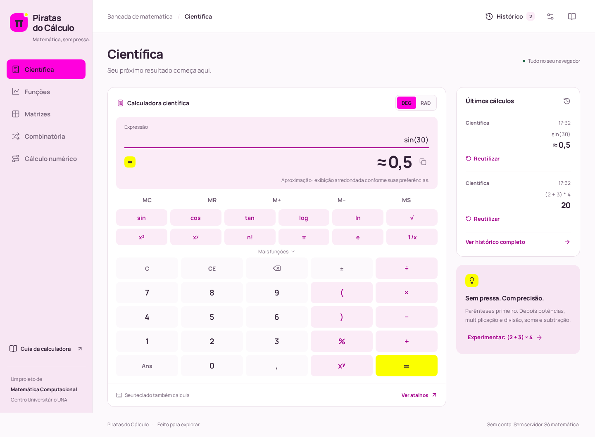
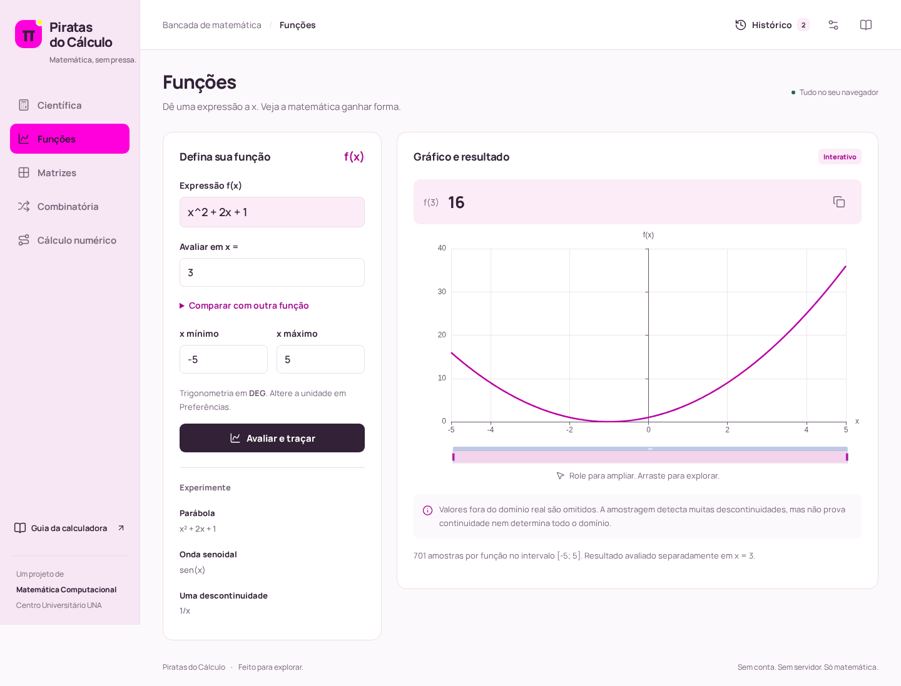
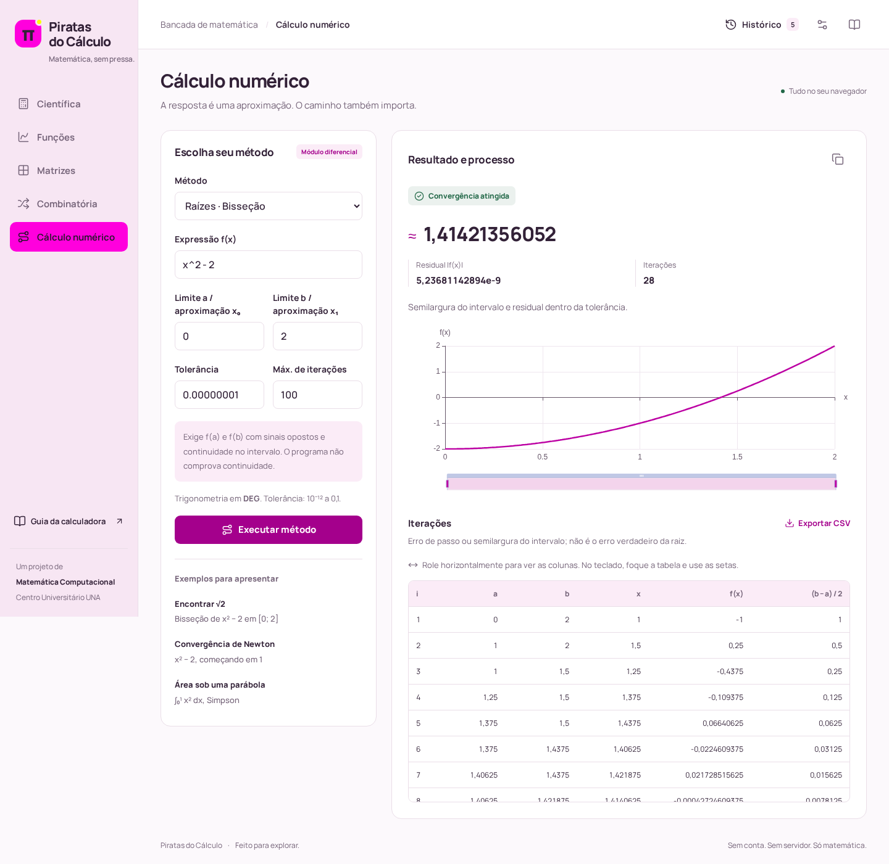

# Piratas do Cálculo

Uma bancada de matemática no navegador: calculadora científica, funções com gráfico, matrizes, combinatória exata e métodos numéricos com iterações visíveis. Sem conta, servidor de aplicação ou banco remoto.

Projeto acadêmico do **Centro Universitário UNA · Contagem**, disciplina **Matemática Computacional**, professor **André Rodrigues**. Identidade inspirada em **Slowpoke**, com rosa `#FF00DD`, amarelo `#FBFF00` e branco `#FFFFFF`.

## Executar localmente

Instale **Node.js 24.x** com npm e abra um terminal na pasta do projeto. Também são compatíveis Node 22.12+ da linha 22 e Node 26+. Não exige Python ou Docker.

```bash
npm install
npm run dev
```

Abra **http://localhost:5173**. Mantenha o terminal aberto e encerre com `Ctrl+C`. Para reinstalação reproduzível com o lockfile, use `npm ci` no lugar de `npm install`.

Os comandos funcionam em Linux, macOS e Windows. No PowerShell, se a política bloquear `npm.ps1`, use `npm.cmd install` e `npm.cmd run dev`. Não é necessário alterar a política de execução. A validação desta entrega foi realizada em Linux com Node 26 e Chromium; Windows e macOS não foram executados nesta máquina.

Para transferir a aplicação a outro computador, leve o código e `package-lock.json`, instale Node e execute os comandos acima. Recrie `node_modules`; não copie essa pasta. O histórico pertence ao navegador e não acompanha o repositório.

## Funcionalidades

| Módulo           | O que oferece                                                                                                                                                                                          |
| ---------------- | ------------------------------------------------------------------------------------------------------------------------------------------------------------------------------------------------------ |
| Científica       | Precedência, parênteses, porcentagem, potências, raízes, logaritmos, trigonometria e inversas DEG/RAD, hiperbólicas, fatorial, arredondamento, piso, teto, módulo, π, e, Ans e memória MC/MR/M+/M−/MS. |
| Funções          | Avaliação de f(x), multiplicação implícita, comparação de duas funções, gráfico cartesiano com zoom, deslocamento e coordenadas.                                                                       |
| Matrizes         | Grade A/B de até 8 × 8; soma, subtração, escalar, produto, determinante, transposta, inversa, traço, potência e identidade.                                                                            |
| Combinatória     | Fatorial, permutação simples e com repetição, arranjo, combinação simples e com repetição; inteiros exatos com BigInt.                                                                                 |
| Cálculo numérico | Bisseção, Newton-Raphson, secante, trapézios compostos e Simpson 1/3; critérios de parada, residual, tabela e exportação CSV.                                                                          |
| Utilidades       | Histórico local de até 100 cálculos, reutilização, exclusão, cópia, exportação TXT, preferências e temas claro/escuro.                                                                                 |

### Expressões e controles

Digite `2 + 3 * 4` para obter `14`, ou `(2 + 3) * 4` para obter `20`. Multiplicação implícita é aceita: `2x`, `2(3+1)`.

- Decimal: ponto ou vírgula entre algarismos (`0.1` ou `0,1`). Para argumentos de funções, use **ponto e vírgula**: `log(8;2)`, `nthRoot(27;3)`.
- `log(x)` / `log10(x)`: base 10. `ln(x)`: base e. `log(x;b)`: base b.
- Porcentagem significa dividir por 100: `200 * 10% = 20`. Não é um modo financeiro de porcentagem contextual.
- `mod(a;b)` usa divisor positivo e resultado no intervalo `[0,b)`: `mod(-7;3) = 2`.
- Divisões decimais finitas e raízes perfeitas são exibidas sem `≈`: `9/3 = 3`, `1/8 = 0,125`, `sqrt(81) = 9`. Dízimas, raízes não exatas e valores arredondados na exibição continuam identificados como aproximações.
- `C` limpa toda a expressão; preserva memória e Ans. `CE` limpa a seleção ou o número imediatamente antes do cursor. Backspace apaga caractere ou seleção.
- `±`, `x²` e `1/x` transformam a seleção; na ausência dela, transformam a expressão inteira.
- `Ans` recupera o último resultado. Memória e Ans duram a sessão da página. `MS`, `M+` e `M−` calculam a expressão atual antes de armazenar.
- O histórico guarda os parâmetros para reutilizar o problema; o resultado é recalculado ao acionar o botão do módulo. Preferências atuais, incluindo unidade angular, continuam valendo.
- Cópia de resultados usa o valor calculado, com ponto decimal. O histórico exporta a representação exibida. Em ambientes que bloqueiam a área de transferência, selecione o texto e use a cópia do sistema.

### Teclado físico

| Tecla                      | Ação na científica                                       |
| -------------------------- | -------------------------------------------------------- |
| `0–9`                      | Números, incluindo teclado numérico com Num Lock ativo   |
| `+ - * /`                  | Operações básicas                                        |
| `.` ou `,`                 | Decimal                                                  |
| `( ) ^ %`                  | Parênteses, potência e porcentagem                       |
| `Enter` ou `=`             | Calcular                                                 |
| `Backspace`                | Apagar                                                   |
| `Escape`                   | C: limpar expressão                                      |
| `Delete`                   | CE: limpar entrada                                       |
| Letras no campo            | Funções, constantes e Ans: `sin(30)`, `sqrt(81)` etc.    |
| `Ctrl/Cmd+C`, `Ctrl/Cmd+V` | Copiar e colar no campo, com atalhos nativos preservados |

As teclas destacam os botões correspondentes. Atalhos da calculadora ficam restritos ao módulo científico e respeitam outros campos, botões com foco, diálogos, modificadores e composição de texto. Os botões virtuais e o teclado acionam as mesmas operações.

## Tecnologias e arquitetura

**TypeScript + Vite**, HTML sem framework de interface; **math.js** para parser e BigNumber; **ECharts** para gráficos; **Lucide** para ícones; **Manrope** hospedada no próprio build; **Vitest** para testes matemáticos e **Playwright** para jornadas no Chromium. A interface foi orientada e revisada com Impeccable. Versões instaladas ficam fixadas em `package.json` e `package-lock.json`.

```text
src/
  main.ts                    # Navegação, diálogos, histórico e preferências
  math/
    expression-engine.ts     # AST permitida e avaliação científica/f(x)
    matrices.ts              # Operações matriciais
    combinatorics.ts         # Inteiros BigInt
    numerical.ts             # Raízes e integração
  modules/                   # Telas dos cinco módulos e gráficos
  services/storage.ts        # Histórico e preferências locais
  styles/main.css            # Tokens, componentes, temas e responsividade
  utils.ts                   # Formatação, DOM seguro, cópia e exportação
 tests/                      # Testes matemáticos e jornadas de navegador
 docs/                       # Documentação acadêmica e capturas reais
```

O motor matemático não conhece o DOM. Não há `eval()` ou `new Function()` no código da aplicação. A AST é validada por lista de nós, símbolos, funções e operadores permitidos e percorrida pelo avaliador; atribuições, acesso a propriedades, listas, strings e comandos são rejeitados. As bibliotecas e telas de gráfico são carregadas sob demanda.

## Fórmulas e métodos

| Operação                      | Fórmula                                   |
| ----------------------------- | ----------------------------------------- |
| Fatorial / permutação simples | `n!`; `0! = 1`                            |
| Permutação com repetição      | `n! / (a! · b! · …)`; soma dos grupos = n |
| Arranjo                       | `A(n,k) = n! / (n−k)!`                    |
| Combinação                    | `C(n,k) = n! / (k! · (n−k)!)`             |
| Combinação com repetição      | `CR(n,k) = C(n+k−1,k)` para n ≥ 1         |

Bisseção divide um intervalo com mudança de sinal; Newton usa `xᵢ₊₁ = xᵢ − f(xᵢ)/f′(xᵢ)`, com derivada central aproximada e passo adaptativo; secante estima a inclinação a partir de duas aproximações. Trapézios e Simpson 1/3 compõem áreas em subdivisões iguais; Simpson exige quantidade par. Veja [fórmulas e critérios de parada](docs/formulas.md).

## Testes e build

```bash
npm test
npm run lint
npm run build
npm run preview
```

`npm test` executa os testes Vitest e termina. `npm run lint` verifica os tipos TypeScript. `npm run preview` serve o build em **http://localhost:4173**. Não abra `dist/index.html` diretamente com `file://`; sirva a pasta por HTTP.

Para jornadas completas em navegador:

```bash
npx playwright install chromium
npm run test:e2e
```

O Playwright inicia o Vite se necessário. Os testes usam contextos isolados, sem limpar o histórico de seu navegador pessoal. Instalar dependências e Chromium exige internet. O aplicativo não usa APIs remotas durante seus cálculos. O detalhamento e os resultados verificados estão em [docs/testes.md](docs/testes.md).

## Publicar gratuitamente

**Estratégia principal: Cloudflare Pages.** Depois de revisar e enviar o código para seu Git:

1. No Cloudflare, abra **Workers & Pages → Create → Pages** e conecte o repositório.
2. Use a raiz do projeto, build `npm run build`, saída `dist`, Node **24** (`NODE_VERSION=24` se necessário).
3. Publique pelo painel. A URL será fornecida pelo serviço; este repositório não contém URL de produção inventada.

Também pode gerar `npm run build` localmente e enviar somente `dist/` pela opção de upload de arquivos do Pages. O Vite usa `base: './'` e navegação por hash para funcionar na raiz e em subdiretórios. [Guia oficial de build do Cloudflare Pages](https://developers.cloudflare.com/pages/configuration/build-configuration/) e [deploy estático do Vite](https://vite.dev/guide/static-deploy).

**Netlify:** conecte o repositório; o `netlify.toml` já informa build, pasta de saída e Node. Para upload manual, envie `dist/`.

**GitHub Pages:** use a configuração GitHub Actions em Settings → Pages. Há um modelo de workflow, desativado por estar em `docs/`, em [docs/github-pages.yml](docs/github-pages.yml). Copie-o para `.github/workflows/deploy.yml` quando decidir publicar e execute-o manualmente pela aba Actions. O modelo passa por testes e build antes de publicar.

Nenhuma publicação ou conexão com conta externa foi realizada nesta entrega. Não há infraestrutura paga ou backend a configurar.

## Limitações matemáticas conhecidas

- Conjunto real; não oferece números complexos ou resolução simbólica geral. Potências fracionárias de bases negativas são rejeitadas; use `nthRoot(-27;3)` para a raiz real ímpar.
- Científica: até **64 algarismos significativos** nas operações decimais. Constantes, trigonometria, logaritmos e outras operações não exatas são aproximações; arredondamentos de exibição também recebem `≈`. Isso não constitui aritmética exata simbólica ou um limite certificado de erro.
- Matrizes e métodos numéricos usam `Number` IEEE-754, cerca de 15–16 algarismos. Inversas mal condicionadas podem ser rejeitadas; determinantes de matrizes quase singulares podem perder precisão.
- Gráficos têm **701 amostras por função** (401 nos métodos), com quebras em pontos inválidos e detecção heurística de saltos. Singularidades muito estreitas podem escapar; o gráfico não prova continuidade nem determina o domínio completo.
- Bisseção exige continuidade fornecida pelo usuário. O critério também exige residual pequeno, para reduzir falsos sucessos em polos. Newton/secante podem divergir ou estagnar. O erro mostrado é o passo entre aproximações ou a semilargura do intervalo, não o erro verdadeiro em relação à raiz desconhecida.
- Integração exige função finita e regular no intervalo. A amostragem não prova integrabilidade; não são calculados limites certificados do erro. Não oferece integrais impróprias.
- Limites: expressão de 512 caracteres e 160 nós; fatoriais e parâmetros combinatórios até 5000; matrizes até 8 × 8; raízes até 500 iterações; integração até 10000 subdivisões. Limites completos: [docs/modulos.md](docs/modulos.md).
- Histórico pode ser apagado pelas configurações do navegador; armazenamento indisponível mantém apenas a sessão. Não há sincronização entre dispositivos, nem instalação offline via service worker.

## Equipe

Nomes e funções do documento oficial:

| Integrante         | Função        |
| ------------------ | ------------- |
| Guilherme Alonso   | QA            |
| Ludmilla Santos    | QA            |
| Olavo Paiva        | Design        |
| Gabriella Chagas   | Líder técnico |
| João Victor Cabral | Dev B         |
| Lucas Cota         | Dev A         |

O PDF apresenta “Desing”; aqui a função foi normalizada para “Design”. As matrículas não são necessárias ao funcionamento e não estão expostas na interface. O documento de primeira entrega contém datas conflitantes entre cronograma e resumo; elas não foram usadas como prova de conclusão do software.

## Documentação e capturas

- [Requisitos e rastreabilidade](docs/requisitos.md)
- [Arquitetura](docs/arquitetura.md)
- [Comportamento dos módulos](docs/modulos.md)
- [Fórmulas e algoritmos](docs/formulas.md)
- [Testes e verificação](docs/testes.md)
- [Roteiro da apresentação](docs/apresentacao.md)





[Captura da calculadora no celular](docs/screenshots/cientifica-mobile.png). Licenças das dependências e da fonte em [public/licenses](public/licenses).

## Status

Os cinco módulos, histórico, teclado, preferências, temas, testes e build estão implementados. As capturas são da aplicação real. Validação local em Chromium/Linux; testes manuais em outros sistemas, revisão acadêmica pelo grupo e publicação em uma conta escolhida pelo usuário permanecem pendentes. Posto de matriz, derivada simbólica, domínio simbólico e sincronização de histórico não foram implementados; são extensões opcionais, não operações oferecidas como prontas.
