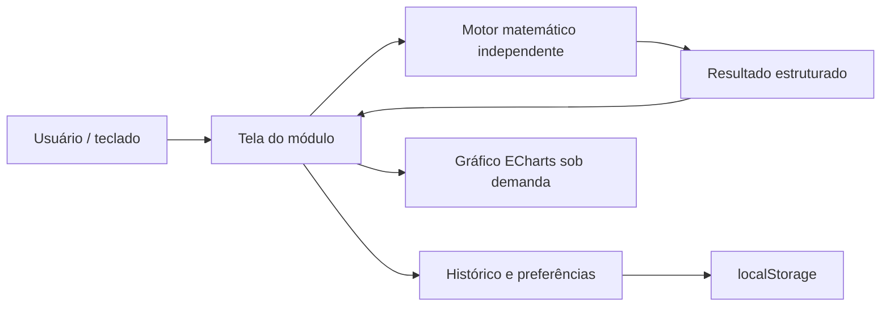

# Arquitetura

Aplicação estática TypeScript, compilada pelo Vite para HTML/CSS/JavaScript. O servidor do Vite é uma ferramenta de desenvolvimento; não é um backend de produção. Hospedagem final serve somente arquivos de `dist/`.

## Responsabilidades

- `src/main.ts`: shell, navegação por hash, carregamento das telas, histórico, preferências e ajuda. Cada montagem retorna uma função que remove listeners e gráficos ao sair.
- `src/modules/`: recebe os valores, chama o motor e apresenta resultados e erros. Não contém os algoritmos centrais.
- `src/math/expression-engine.ts`: normalização, parser math.js, validação da AST e percurso controlado. Aceita apenas operadores e funções conhecidos; modo decimal científico e modo Number para amostragem usam a mesma árvore e regras de domínio.
- `src/math/matrices.ts`: operações até 8 × 8, pivotamento em determinantes/inversas e validação dimensional.
- `src/math/combinatorics.ts`: contagem exata por BigInt, sem conversão do resultado para Number.
- `src/math/numerical.ts`: limites, validações, métodos e critérios de parada. Retorna iterações e estado explícito de convergência.
- `src/services/storage.ts`: até 100 registros, parâmetros de reutilização e preferências em uma chave versionada. Conteúdo lido é validado; falha de persistência não impede cálculos.
- `src/modules/chart.ts` / `chart-library.ts`: amostragem com quebras e gráfico de linhas, com destruição e ResizeObserver.
- `src/utils.ts`: formatação, erros, escapes de HTML, leitura de números e exportações.

## Segurança e privacidade

Não há autenticação, cookies ou tráfego para APIs de cálculo. Fontes e bibliotecas são entregues pelo próprio build. Expressões não são executadas como JavaScript. Atribuições, blocos, listas, indexação, propriedades e funções não permitidas são rejeitadas. O conteúdo dinâmico é inserido como texto ou escapado. Limites de expressão e algoritmos reduzem risco de travamento. Histórico e preferências permanecem no navegador.

## Precisão

BigNumber com 64 algarismos significativos na científica; combinatória usa BigInt. Matrizes e métodos numéricos usam IEEE-754. O número formatado e o valor interno são separados. Não há promessa de álgebra exata ou verificação formal de erro.

## Portabilidade

Sem framework de interface ou dependências de sistema além de Node para construir. A navegação por hash e `base: './'` permitem hospedagem estática em subdiretórios. O projeto funciona em outra máquina sem Codex, Impeccable ou configurações locais de agentes.
